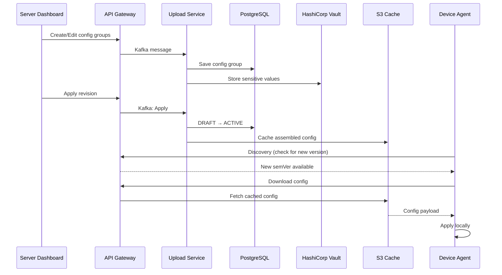
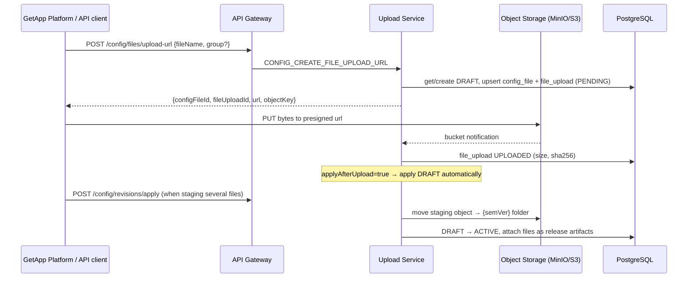

# GetConfig - Configuration Management

## Introduction

GetConfig is a centralized configuration management system that enables you to define, version, and distribute runtime configuration to your device fleet. It supports key-value configuration groups, **binary configuration files** (certificates, licenses, templates, and so on), semantic versioning, sensitive value storage (via Vault), ConfigMap inheritance, and automatic sync to agents.

## Key Concepts

### Config Projects

A **Config Project** is a project of type `CONFIG` that holds configuration intended for devices. Config projects are **created automatically** when a new device performs its first discovery — they do not need to be created manually from the Dashboard. Each config project contains revisions, and each revision contains one or more configuration groups.

### Configuration Groups

A **Configuration Group** is a named collection of key-value pairs written in YAML. Groups allow you to organize configuration logically (e.g., `network`, `logging`, `application`).

Each group has:
- **Name**: Unique identifier within the revision
- **Display Name**: Human-readable label
- **YAML Content**: The actual key-value configuration
- **Sensitive Keys**: Keys whose values are stored securely in Vault
- **Position**: Ordering within the revision

### Config Files (Binary Attachments)

A **Config File** is a binary file (any format, such as a `.pem` certificate, a `.lic` license or
a `.json` template) attached to a config revision and delivered to the device with the
key-value groups. Each file can be:

- **Associated with a group:** the file belongs to that group and lands next to the group's
  YAML on the device. A group can hold **any number** of files.
- **Not associated with any group (ungrouped):** the file belongs to the revision itself and
  lands at the root of the device config folder.

Files are versioned with the revision like groups. Adding or replacing a file bumps the
**minor** version, and removing one bumps the **major** version, even when no YAML value
changed.

### Revisions

Revisions provide versioning for your configuration. Each revision goes through a lifecycle:

1. **DRAFT** — Editable state; only one draft can exist at a time
2. **ACTIVE** — The currently deployed revision; applied to devices
3. **ARCHIVED** — Previously active revisions kept for history

When a draft is applied, it becomes ACTIVE, the previous active revision becomes ARCHIVED, and a semantic version is automatically computed.

### ConfigMaps

A **ConfigMap** is a special project type that provides shared configuration across multiple config projects. ConfigMaps can be associated with:
- Specific **device types**
- Specific **device IDs**

When a ConfigMap revision is applied, all linked device configs are automatically refreshed.

### Local Overrides

Agents can apply **local overrides** to specific configuration keys. These overrides take precedence over server-distributed values, allowing device-specific adjustments without modifying the central configuration.

## Architecture Overview



## Managing Configurations

### Config Project Creation

Config projects are created automatically when a new device performs its first discovery against the server. There is no need to manually create them from the Dashboard. Once a device completes discovery, its corresponding config project appears in the **Devices** list, ready for you to manage its configuration.


### Working with Revisions

#### Creating a Draft

1. Open the device config page
3. Click **Edit** to start a new revision


#### Adding Configuration Groups

1. In the active draft, click **Add Group**
2. Provide a **Name** and **Display Name**
3. Enter your configuration in key value/ or YAML format
4. Mark any sensitive keys that should be stored in Vault
5. Click **Save**


#### Editing Groups

1. Select an existing group from the list
2. Modify the content or group properties
3. Click **Save**


#### Applying a Revision

1. Review all groups in the draft
2. Click **Save**

:::caution
Applying a revision immediately makes it available to all targeted devices on their next sync. Ensure you have tested the configuration before applying.
:::

#### Viewing Revision History

The history shows all past revisions with their version numbers, status, and timestamps.


### Managing Sensitive Values

Configuration values marked as **sensitive** are stored in HashiCorp Vault and are never exposed in plaintext through the API or UI. They appear masked as `***` in the interface.

To mark a key as sensitive:
1. Edit the configuration group
2. Select the key(s) to mark as sensitive
3. Save the group


### Managing Binary Config Files

Binary files are managed in the same **Device Config** editor as the groups.

#### Uploading a file to a group

1. Open the device config page.
2. On the group header, click **Upload files** (*Upload files to this group*).
3. Pick one or more files. They upload directly to object storage.
4. When the upload finishes, the UI waits for the server to record each file's size and
   SHA-256, then **applies the revision automatically**. A new ACTIVE version is published,
   and devices receive the files on their next sync.


#### Uploading a file without a group

At the bottom of the group list, the **No group** section has its own **Upload files**
button. Files uploaded there aren't associated with any group. They're delivered to the
root of the device config folder (see [On-Device Storage](#on-device-storage)).

#### Viewing and deleting files

Uploaded files are listed under the group they belong to (or under **No group**), below the
group's keys, as shown in the screenshot above. Click the delete icon next to a file to
remove it. Deleting a file also creates a draft and applies it
immediately, which publishes a new version without the file. The device removes the file on
its next sync. Older revisions in **History** still show the files they had.

#### Upload flow



**Object storage layout** (bucket `BUCKET_NAME`). The owner is the device id for a device
config project, or `cm-<projectId>` for a ConfigMap:

| Stage | Key |
|---|---|
| Draft (staging) | `upload/config-files/<owner>/staging/[<group>/]<fileName>` |
| Applied revision | `upload/config-files/<owner>/<semVer>/[<group>/]<fileName>` |

When a new draft is created, the previous revision's files are carried forward **by
reference**, so unchanged files aren't copied. Replacing a file in a draft creates a new
upload, while older revisions keep pointing at their own content.

:::tip
Use simple file names (`A-Z a-z 0-9 . _ -`). Other characters are replaced with `_` in the
storage key.
:::

### ConfigMap Management

ConfigMaps allow you to define shared configuration that can be inherited by multiple config projects.

#### Creating a ConfigMap Project

1. Create a project of type **CONFIG_MAP**. The GetApp Platform
   [New Project](../../../user-docs/developer/project/new-project.md) wizard offers only
   Application and Infrastructure by default, so an administrator must first add
   **Config map** to the wizard with a
   [layout override](../../../user-docs/developer/project/new-project.md#customizing-the-form)
2. Define your shared configuration groups


#### Associating ConfigMaps

1. Open your ConfigMap project
2. Navigate to **Associations**
3. Link the ConfigMap to specific **device types** or **device IDs**
4. Select which Config projects should inherit this ConfigMap


#### ConfigMap Cascade Behavior

When a ConfigMap revision is applied:
- All linked Config projects are automatically refreshed
- Device configs are reassembled with the updated ConfigMap values
- Agents receive the updated configuration on their next sync

#### ConfigMap Files

ConfigMaps can carry binary files too, uploaded per group or without a group, in the same way
as device configs. A device receives the files of every ConfigMap that applies to it, plus
its own config project's files:

- If the device's config project and a ConfigMap both provide a file with the **same group
  and file name**, the **device config project's file wins**.
- Files with the same name in **different groups** don't conflict. Both are delivered.

In the **ConfigMaps** panel, each group and the **No group** section have their own
**Upload files** button:


## Device Configuration View

### Assembled Device Config

The Dashboard provides a view of the final assembled configuration for each device, showing the merged result of:
- Device-specific config groups
- Inherited ConfigMap groups
- Global groups


### Table View — Multi-Device Config Editing

The Dashboard provides a **Table View** that lets you view and edit configuration across multiple devices at once. Switch to it from the **Devices** list by changing the view mode to **Config**.

The table displays a matrix of **devices (rows) × config keys (columns)**, grouped under their config group headers. Click any editable cell to modify its value inline — ConfigMap-inherited groups are read-only. Modified cells are highlighted, and clicking **Save** applies all pending changes across all affected devices at once.


## Server API Reference

### Addressing a Config Project (`:id`)

Every GetConfig endpoint takes the project in the path as `:id` (`configIdentifier`). It can
be any of these:

| Form | Example | Notes |
|---|---|---|
| Project ID | `128` | Numeric ID of a CONFIG or CONFIG_MAP project |
| Project name | `config:DEV-1234`, `shared-network` | A device config project is always named `config:<deviceId>` |
| Bare device ID | `DEV-1234` | The `config:` prefix is **optional**. If the identifier doesn't match a project as-is, the server retries it as `config:<identifier>`. |

So these three calls hit the same project:

```bash
GET /api/v1/get_config/128/config/revisions
GET /api/v1/get_config/config:DEV-1234/config/revisions
GET /api/v1/get_config/DEV-1234/config/revisions
```

:::note
The exact identifier is tried first. If another project (for example a ConfigMap) is named
exactly like the device ID, use the full `config:<deviceId>` name to reach the device's config
project.
:::

### Config Endpoints

| Method | Endpoint | Role | Description |
|--------|----------|------|-------------|
| `GET` | `/api/v1/get_config/:id/config/revisions?includeGroups=` | `VIEW_CONFIG_REVISION` | List all revisions. `includeGroups=true` also returns each revision's groups. |
| `GET` | `/api/v1/get_config/:id/config/revisions/:revisionId?includeGroups=` | `VIEW_CONFIG_REVISION` | Get a specific revision |
| `POST` | `/api/v1/get_config/:id/config/revisions/draft?includeGroups=` | `MANAGE_CONFIG_REVISION` | Create a new draft, seeded with the ACTIVE revision's groups and files. Fails if a draft already exists. `includeGroups=true` returns the seeded groups. |
| `DELETE` | `/api/v1/get_config/:id/config/revisions/draft` | `MANAGE_CONFIG_REVISION` | Discard the current draft |
| `POST` | `/api/v1/get_config/:id/config/revisions/apply` | `MANAGE_CONFIG_REVISION` | Apply the draft (DRAFT → ACTIVE). Optional body `{ "appliedBy": "…" }`, which defaults to the caller's email. |
| `PUT` | `/api/v1/get_config/:id/config/groups` | `MANAGE_CONFIG_GROUP` | Create or update a group in the draft. Supports `apply` (see below). |
| `DELETE` | `/api/v1/get_config/:id/config/groups` | `MANAGE_CONFIG_GROUP` | Delete a group from the draft. Body `{ "groupName": "…", "apply": false }` |
| `GET` | `/api/v2/get_config/:id/config/device-config/version/:semver?` | `VIEW_CONFIG_REVISION` | Get the assembled device config. Returns the **latest ACTIVE** version when `:semver` is omitted. |
| `GET` | `/api/v1/get_config/:id/config/device-config/:deviceId/version/:semver` | `VIEW_CONFIG_REVISION` | **Deprecated.** Use the v2 endpoint above. |

### Automatic Drafts

You don't need to call `revisions/draft` before making changes. Changing groups or files
(`PUT /groups`, `DELETE /groups`, `files/upload-url`, `DELETE /files/:configFileId`)
**creates a DRAFT automatically** if none exists. The new draft is seeded with the ACTIVE
revision's groups and files, so applying it never drops anything you didn't change.

### Apply Options

Every change can either stay in the draft (so you can batch several changes) or be published
immediately:

| Where | Option | Effect |
|---|---|---|
| `PUT /groups` body | `"apply": true` | Save the group and apply the draft in the same call |
| `DELETE /groups` body | `"apply": true` | Delete the group and apply the draft in the same call |
| `POST /files/upload-url` body | `"applyAfterUpload": true` | Apply the draft automatically once the file upload is finalized |
| `DELETE /files/:configFileId` body | `"apply": true` | Remove the file and apply the draft in the same call |
| `POST /revisions/apply` | — | Apply everything staged in the draft at once |

All these flags default to `false`. When applying, `appliedBy` is filled from the
authenticated user if you don't send it.

**`PUT .../config/groups`** body:

| Field | Type | Required | Description |
|---|---|---|---|
| `name` | string | yes | Group name |
| `displayName` | string | no | Human-readable label (falls back to `name`) |
| `isGlobal` | boolean | no | Global group, merged into every other group of the project |
| `yamlContent` | string | no | The group's full YAML. It replaces the existing content. |
| `sensitiveKeys` | string[] | no | Dot-notation paths stored in Vault and returned as `***`. It replaces the previous list. Sending `***` for a sensitive key keeps the existing secret. |
| `gitFilePath` | string | no | YAML file in the Git repo that populates this group (GitOps) |
| `apply` | boolean | no | Apply the draft right after saving. Default `false`. |

```bash
# Update one group on a device and publish it immediately; no draft handling or config: prefix needed
curl -X PUT "$API/api/v1/get_config/DEV-1234/config/groups" \
  -H "Authorization: Bearer $TOKEN" -H "Content-Type: application/json" \
  -d '{"name":"network","yamlContent":"proxy:\n  host: 10.0.0.5\n  port: 3128\n","apply":true}'

# Fetch the latest assembled config for the same device
curl "$API/api/v2/get_config/DEV-1234/config/device-config/version" -H "Authorization: Bearer $TOKEN"
```

### Config File Endpoints

`:id` follows the [same addressing rules](#addressing-a-config-project-id), including the
optional `config:` prefix. The same endpoints work for ConfigMap projects.

| Method | Endpoint | Role | Description |
|--------|----------|------|-------------|
| `POST` | `/api/v1/get_config/:id/config/files/upload-url` | `MANAGE_CONFIG_GROUP` | Create (or replace) a file in the DRAFT revision and get a presigned PUT URL |
| `GET` | `/api/v1/get_config/:id/config/files?revisionId=` | `VIEW_CONFIG_REVISION` | List the files of a revision (defaults to the DRAFT) |
| `DELETE` | `/api/v1/get_config/:id/config/files/:configFileId` | `MANAGE_CONFIG_GROUP` | Remove a file from the DRAFT revision |

**`POST .../config/files/upload-url`**: request body:

| Field | Type | Required | Description |
|---|---|---|---|
| `fileName` | string | yes | File name on the device and in storage |
| `group` | string | no | Group to associate the file with. Omit it for an **ungrouped** file. |
| `contentType` | string | no | Defaults to `application/octet-stream` |
| `applyAfterUpload` | boolean | no | `true`: apply the DRAFT automatically when this upload is finalized. `false` (default): stage several files and apply them together with `revisions/apply`. |

Response:

```json
{
  "configFileId": 42,
  "fileUploadId": 99,
  "url": "https://<object-storage>/...presigned...",
  "objectKey": "upload/config-files/DEV-1234/staging/network/ca-cert.pem"
}
```

Then upload the bytes with a plain `PUT` to `url`. No extra "complete" call is needed. The
server finalizes the file (status `uploaded`, size, SHA-256) when object storage reports the
upload.

```bash
# 1. Request an upload URL for a file in the "network" group
curl -X POST "$API/api/v1/get_config/DEV-1234/config/files/upload-url" \
  -H "Authorization: Bearer $TOKEN" -H "Content-Type: application/json" \
  -d '{"fileName":"ca-cert.pem","group":"network","applyAfterUpload":true}'

# 2. Upload the bytes to the returned presigned URL
curl -X PUT --upload-file ./ca-cert.pem "$URL"
```

**`GET .../config/files`**: each item is a `ConfigFileDto`: `id`, `revisionId`, `group`
(or `null`), `fileName`, `size`, `sha256`, `status` (`pending` until finalized), and
`position`.

**`DELETE .../config/files/:configFileId`**: body `{ "apply": true }` applies the DRAFT
immediately after the removal.

:::caution
Apply a revision only after its files have left the `pending` status. A file that is still
pending is left out of the device config, so devices won't receive it.
:::

In the assembled device config, the files appear in `configFiles`:

```json
{
  "deviceId": "DEV-1234",
  "semVer": "1.5.0",
  "groups": { "network": { "proxy": { "host": "10.0.0.5" } } },
  "configFiles": [
    { "fileName": "ca-cert.pem", "group": "network", "size": 2048, "sha256": "ab12…", "itemKey": "…@network/ca-cert.pem" },
    { "fileName": "license.lic", "group": null, "size": 512, "sha256": "cd34…", "itemKey": "…@_/license.lic" }
  ]
}
```

When the revision is applied, the device's effective files are attached to the config
release as installation artifacts with a `relativePath` of `[<group>/]<fileName>`. The agent
downloads them through the standard delivery flow.

### ConfigMap Endpoints

Here `:id` is the ConfigMap project's ID or name, except for `config-maps`, which takes the
CONFIG project.

| Method | Endpoint | Role | Description |
|--------|----------|------|-------------|
| `GET` | `/api/v1/get_config/:id/config-map/associations` | `VIEW_CONFIG_MAP` | List associations |
| `GET` | `/api/v1/get_config/:id/config-map/affected-devices` | `VIEW_CONFIG_MAP` | List every device the ConfigMap applies to, directly or through a device type (`deviceId`, `associationType`, `associationValue`) |
| `POST` | `/api/v1/get_config/:id/config-map/associations` | `MANAGE_CONFIG_MAP` | Add associations. Body `{ "deviceTypeId"?: number, "deviceIds"?: string[] }`. At least one of the two is required. |
| `DELETE` | `/api/v1/get_config/:id/config-map/associations/:associationId` | `MANAGE_CONFIG_MAP` | Remove an association |
| `GET` | `/api/v1/get_config/:id/config/config-maps` | `VIEW_CONFIG_MAP` | List the ConfigMaps that apply to a CONFIG project |

Groups, revisions and files of a ConfigMap are managed with the same
[Config Endpoints](#config-endpoints), [Apply Options](#apply-options) and
[Config File Endpoints](#config-file-endpoints), using the ConfigMap's ID or name as `:id`.

### Agent-Side Configuration

On the device, the agent exposes configuration to local applications through its local API:

| Endpoint | Description |
|----------|-------------|
| `GET /api/v2/config/file` | Complete device config (all groups). `?format=yaml` returns one YAML document rebuilt from the group files. |
| `GET /api/v2/config/groups` | List all group names |
| `GET /api/v2/config/group/{name}` | Get all key-values for a group |
| `GET /api/v2/config/group/{name}/path` | Absolute path of the group's YAML file on disk (`{ "group", "path" }`) |
| `GET /api/v2/config/group/{name}/env/{key}` | Get a single value |
| `GET /api/v2/config/revision` | SemVer of the config revision currently applied on the device |
| `GET /api/v2/config/overrides` | View all local overrides |
| `PUT /api/v2/config/overrides/{group}/{key}` | Set a local override |
| `DELETE /api/v2/config/overrides/{group}/{key}` | Remove a local override |

### Local Overrides

Agents can override individual configuration values locally without affecting the server-side configuration. Overrides are managed via the agent's local API:

| Method | Endpoint | Description |
|--------|----------|-------------|
| `GET` | `/api/v2/config/overrides` | View all local overrides |
| `GET` | `/api/v2/config/overrides/{group}` | View overrides for a specific group |
| `PUT` | `/api/v2/config/overrides/{group}/{key}` | Set a local override |
| `DELETE` | `/api/v2/config/overrides/{group}/{key}` | Remove a local override |

:::info
Local overrides persist across config syncs. They take precedence over server-distributed values until explicitly removed.
:::

## On-Device Storage

### One YAML file per group

The agent stores the synced config as a **folder with one YAML file per group**, not as a
single file:

```
{data_dir}/data/device-config/
├── getapp_config.yaml
├── network.yaml          ← group "network" (key/values only)
├── network/              ← binary files associated with "network"
│   ├── ca-cert.pem
│   └── proxy.pac
├── application.yaml
└── license.lic           ← ungrouped binary file (revision root)
```

| Mode | Default `{data_dir}` |
|---|---|
| Windows service | `%DataPath%\GetAppData` |
| Linux service | `/var/lib/getapp` (or `DATA_PATH` in `/etc/getapp/getapp-release`) |
| Console | `./GetAppData` |

Set the `CONFIG_DIR` environment variable to override the folder.

This layout lets a third-party tool read **only its own group's file**. It doesn't need to
parse or filter the other groups, so each group stays isolated:

- On every sync, each group is written to `<group>.yaml`. Files of groups that no longer exist
  are removed, so the folder always mirrors the latest revision.
- Group names containing `/`, `\` or `..` are rejected, to prevent writing outside the folder.
- Use `GET /api/v2/config/group/{name}/path` to get the absolute path of a group's file, or
  `{ConfigPath.<group>}` in a Deploy V2 manifest.
- `GET /api/v2/config/file?format=yaml` still returns the full config as one YAML document,
  rebuilt from the group files.

:::info[Migration from the single-file layout]
Older agents stored all groups in one file, `{data_dir}/data/device-config.yaml`. At
start-up, the agent splits that file into the per-group folder and deletes it. If the split
fails, the legacy file is kept, so no data is lost. Configs cached for managed devices
(formerly `{data_dir}/data/devices-config/`) are migrated into the components folder
described below.
:::

### Where binary files end up

Binary files are downloaded through the **standard delivery flow**, like any other
component artifact, and checked against their SHA-256:

1. **Download (revision cache):** files land in the components folder, in a per-revision
   directory next to the rendered config:

   ```
   {data_dir}/data/comps/config_<deviceId>/<semVer>/
   ├── config.json           ← rendered device config
   ├── network/ca-cert.pem
   └── license.lic
   ```

   The `[<group>/]<fileName>` structure comes from each artifact's `relativePath`. A file
   whose SHA-256 matches a file already on disk from a previous revision is reused instead of
   downloaded again. A CDN agent also uses this cache to serve the files to its child
   devices.

2. **Live folder (this device):** for the agent's own config, the revision folder is
   **mirrored** into `{data_dir}/data/device-config/` once the delivery completes:
   - Files associated with a group go to `device-config/<group>/<fileName>`, next to
     `<group>.yaml`.
   - Ungrouped files go to `device-config/<fileName>`.
   - Binaries that are no longer in the revision are deleted. Group `*.yaml` files are never
     touched by this step.

3. **Clean-up:** superseded revision folders under `comps/config_<deviceId>/` are removed
   only **after** the new delivery succeeds, so their files remain available for reuse during
   the download.

:::note
If an **ungrouped** file is itself named `config.json`, the rendered device config in the
revision folder is stored as `config.device.json` instead, so the two files don't clash.
:::

## The `getapp_config` Reserved Group

The `getapp_config` group is a **reserved configuration group** that directly controls the behavior of the GetApp agent itself. Unlike regular groups that are simply exposed via the local API, values in `getapp_config` are **automatically merged into the agent's own `config.yaml`** on every sync.

This provides a powerful mechanism for remotely managing agent settings across your device fleet from the Dashboard, without needing to manually update each device.

### How It Works

1. The server always includes `getapp_config` as a default group in every config project
2. When the agent syncs its configuration, it extracts the `getapp_config` group
3. Each key-value pair is **validated** against expected types
4. Valid values are **deep-merged** into the agent's `config.yaml`
5. Affected subsystems are **hot-reloaded** — no agent restart required

### Merge Behavior

- **Deep recursive merge** — nested settings are merged at the leaf level
- **Only provided keys are affected** — keys absent from `getapp_config` are left untouched in the local config
- **Type safety** — known keys are type-checked; mismatched types are rejected and logged as errors
- **Unknown keys** are accepted and passed through without type validation

### `local_config_priority` Flag

The agent has a special `device.local_config_priority` setting (default: `false`) that controls merge precedence:

| `local_config_priority` | Behavior |
|--------------------------|----------|
| `false` (default) | **Server wins** — `getapp_config` values overwrite local values |
| `true` | **Local wins** — only keys *absent* locally are written from the server |

:::caution
The `device.local_config_priority` flag itself is **protected** — it cannot be overwritten remotely via `getapp_config`. It can only be changed directly on the device.
:::

### Available Settings

The following agent settings can be controlled remotely via the `getapp_config` group:

#### Device Settings

| Key | Type | Description |
|-----|------|-------------|
| `device.device_id` | String | Device identifier |
| `device.device_type_token` | Array | Device type tags |
| `device.platform` | String | Platform type |
| `device.platform_id` | String | Platform identifier |
| `device.meta_data.name` | String | Device display name |
| `device.meta_data.misc` | String | Misc metadata |

#### Network Settings

| Key | Type | Description |
|-----|------|-------------|
| `network.getapp_server_urls` | Array | Server URLs |
| `network.availability_url` | String | Network availability check URL |
| `network.net_tcp_stream_timeout_sec` | Number | TCP stream timeout (seconds) |

#### Discovery Settings

| Key | Type | Description |
|-----|------|-------------|
| `discovery.periodic_interval_min` | Number | Discovery interval (minutes) |
| `discovery.stale_after_mins` | Number | Discovery staleness threshold (minutes) |
| `discovery.component_last_run` | String | Last component discovery timestamp |

#### Delivery Settings

| Key | Type | Description |
|-----|------|-------------|
| `delivery.delivery_auto_trigger` | Bool | Auto-trigger delivery after discovery |
| `delivery.delivery_storage_buffer_bytes` | Number | Storage buffer size (bytes) |
| `delivery.use_only_artifacts_size_for_storage_calculation` | Bool | Artifact size calculation mode |
| `delivery.max_parallel_deliveries` | Number | Maximum parallel downloads |
| `delivery.delivery_timeout_mins` | Number | Delivery timeout (minutes) |
| `delivery.delivery_retry_count` | Number | Number of delivery retries |

#### Deploy Settings

| Key | Type | Description |
|-----|------|-------------|
| `deploy.deploy_auto_on_pull` | Bool | Auto-deploy after pull |
| `deploy.deploy_timeout_sec` | Number | Deploy timeout (seconds) |

#### Release Health Check Settings

| Key | Type | Description |
|-----|------|-------------|
| `releases.health_check_timeout_secs` | Number | Health check timeout (seconds) |
| `releases.health_check_interval_mins` | Number | Health check interval (minutes) |

#### General & Logging Settings

| Key | Type | Description |
|-----|------|-------------|
| `general.query_status_interval_sec` | Number | Status polling interval (seconds) |
| `logs.logs_run_dispatch_job` | Bool | Enable log dispatch job |

#### Analytics (Matomo) Settings

| Key | Type | Description |
|-----|------|-------------|
| `matomo.matomo_use_buffer` | Bool | Buffer analytics events |
| `matomo.matomo_server_url` | String | Matomo server URL |
| `matomo.matomo_site_id` | Number | Matomo site ID |
| `matomo.matomo_dimension_id` | Number | Matomo dimension ID |
| `matomo.matomo_max_retention_hours` | Number | Matomo retention period (hours) |
| `matomo.matomo_max_buffer_size_mb` | Number | Matomo buffer size (MB) |

### Hot-Reload Behavior

After merging `getapp_config` values, the agent hot-reloads affected subsystems:

- **Network/Delivery changes** — refresh the HTTP client pool immediately
- **Discovery changes** — reset the discovery scheduler interval
- **Other settings** — picked up automatically on the next loop iteration

### Example

A `getapp_config` group with the following YAML content:

```yaml
discovery:
  periodic_interval_min: 10
delivery:
  max_parallel_deliveries: 3
  delivery_auto_trigger: true
network:
  net_tcp_stream_timeout_sec: 30
```

This would configure all devices receiving this config to:
- Run discovery every 10 minutes
- Allow up to 3 parallel deliveries with auto-trigger enabled
- Set TCP stream timeout to 30 seconds

## Configuration Sync

### How Sync Works

1. During **discovery**, the agent compares its local config version with the server-advertised version
2. If a newer version is available, the agent downloads the updated configuration
3. The groups are written to the per-group folder ([On-Device Storage](#on-device-storage)) and made available through the local API
4. If a `getapp_config` group exists, its values are [merged into the agent's settings](#the-getapp_config-reserved-group)
5. If the revision has `configFiles`, the agent starts a delivery for them and mirrors them into `device-config/` when it completes. If the revision has no files, stale binaries are removed immediately.
6. The `ConfigChange` SSE event ([`/events/getconfig`](../interfaces/sse)) is broadcast **only after the groups and all binary files are in place**, so subscribers never see a partial config

### Sync Triggers

- Automatic periodic discovery cycle
- Manual sync initiated from the Agent UI
- Device restart

### Offline Behavior

Configuration is cached locally on the device. If the device loses connectivity:
- The last synced configuration remains available
- Local overrides continue to function
- The agent will sync the latest version once connectivity is restored

## Using Config in Deploy V2 Manifests

A release's `install.yaml` can read the synced config groups at install time through placeholders,
so one manifest adapts to each device's configuration:

| Placeholder | Resolves to |
|---|---|
| `{Config.<group>.<key>}` | The value at that key: a scalar or a JSON object/array (e.g. `{Config.network.proxy.host}` or `{Config.network.proxy}`). Objects/arrays are embedded as JSON when the placeholder is the entire request `Body` value or a field value within it; use `ConfigJson` in string contexts. |
| `{Config.<group>}` | The whole group — embedded as JSON when it is the only content of a request `Body` value |
| `{ConfigJson.<group>}` | The group (or value) as compact JSON text, for command-line arguments and query params |
| `{ConfigPath.<group>}` | The absolute path of the group's YAML file on the device (`.../device-config/<group>.yaml`), so a script or tool can read it. The group's binary files are in the sibling folder `.../device-config/<group>/`. |

The agent's own runtime settings are read with `{DeviceConfig.<zone>.<key>}`. See
[Deploy V2 — Tasks](../../../user-docs/developer/deploy/v2/deploy-v2-tasks#placeholders--dynamic-values-at-runtime)
for the full rules.

## CDN Configuration Distribution

A CDN agent (master node) can act as a local configuration and command server for managed
devices that lack direct connectivity to the GetApp server — see [CDN Configure](../fleet-connectivity/cdn-configure)
for the full distribution flow, sync process, and API reference.

## Best Practices

### Configuration Organization

- **Group by domain**: Separate configuration into logical groups (e.g., `network`, `security`, `application`)
- **Use meaningful names**: Group and key names should be self-explanatory
- **Keep groups focused**: Each group should have a single responsibility

### Security

- **Mark sensitive values**: Always mark passwords, tokens, and secrets as sensitive
- **Limit access**: Use role-based permissions to control who can modify configurations
- **Audit changes**: Review revision history regularly

### Rollout Strategy

- **Test before applying**: Validate configuration changes on test devices first
- **Use ConfigMaps for shared config**: Avoid duplicating the same values across multiple projects
- **Version awareness**: Use semantic versioning to track meaningful changes

### Local Overrides

- **Use sparingly**: Local overrides make central management harder
- **Document overrides**: Keep track of which devices have overrides and why
- **Clean up**: Remove overrides once the central config is updated

## Troubleshooting

### Configuration Not Syncing

1. Verify the revision is in **ACTIVE** status
2. Check that the device is connected and discovery is running
3. Confirm the config project is associated with the device (via offering)
4. Check agent logs for sync errors

### Binary Files Not Arriving on the Device

1. In `GET /config/files?revisionId=<active>`, check that each file's `status` isn't
   `pending`. Pending files are left out of the device config.
2. Confirm the device's config `semVer` (`GET /api/v2/config/revision` on the agent) matches
   the active revision.
3. Check the agent's deliveries for the config catalog id and look for SHA-256 validation
   errors in the agent log.
4. Look in `{data_dir}/data/comps/config_<deviceId>/<semVer>/`. If the files are there but
   not in `device-config/`, the delivery didn't complete.

### Sensitive Values Not Resolving

1. Verify Vault connectivity from the server
2. Check that the keys are correctly marked as sensitive
3. Review Upload service logs for Vault errors

### ConfigMap Changes Not Propagating

1. Ensure the ConfigMap revision has been **applied**
2. Verify associations are correctly configured
3. Check that linked Config projects have active revisions

## Next Steps

- [Policy](../../../user-docs/admin/create-and-manage-rule/policy) — control which devices receive specific releases
- [Restrictions](../../../user-docs/admin/create-and-manage-rule/restrictions) — define device-level installation rules
- [GitOps Releases](../../server/gitops-section/gitops-releases.md) — automate configuration via Git workflows
- [CDN Configure](../fleet-connectivity/cdn-configure) — CDN agent distribution, sync, and API reference
