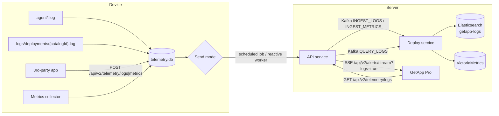
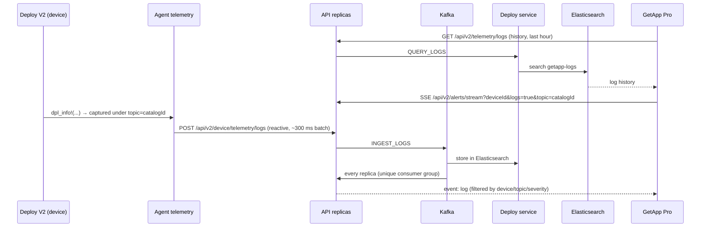

# Telemetry — Agent Logs and Metrics

## Introduction

Telemetry is the pipeline that moves **logs** and **metrics** from devices to the GetApp
server so they can be searched, charted and — for installations — watched **live** from
GetApp Pro.

On the device, the agent gathers four kinds of data:

| Source | What it is | Telemetry `topic` |
|---|---|---|
| **Agent logs** | The agent's own log (`agent*.log`) | `agent` |
| **Deployment (component) logs** | The per-release deploy log written while a component is installed, updated or removed | The component's **catalog id**, e.g. `52.orchestrator-test@1.0.0` |
| **Third-party logs & metrics** | Anything a local application reports to the agent through its local API | Chosen by the reporting app |
| **System metrics** | CPU, memory, disk and network usage sampled by the agent | `agent` |

All data is written to a local SQLite store first (`telemetry.db`), then sent to the server
either on a **schedule** or **immediately** (reactive mode). On the server, logs are stored
in **Elasticsearch** and metrics in **VictoriaMetrics**.



---

## 1. Collecting data on the device

### Agent logs

The agent reads its own log files (`agent*.log` in the logs directory) and parses each
`TIMESTAMP | LEVEL | MODULE:LINE — MESSAGE` line into a log entry. Only entries at or above
`telemetry.log_min_level` (default `ERROR`) are kept. Entries are stored with
`group = "agent"` and `topic = "agent"`, and `module` and `line` are added to `metadata`.

A watermark (`last_log_collect` in `telemetry.db`) records how far collection has read, so
each line is collected only once. On the first run, collection starts one hour back.

### Deployment logs — collected per component

Every Deploy V2 run (install, update, uninstall or another lifecycle action) writes a
dedicated log file per release in the logs directory:

```
<logs_dir>/deployments/<catalog_id>.log
```

The file is UTF-16LE, in the format `[<rfc3339>] [<LEVEL>] <module>:<line> — <message>`.
For more details, see [Deploy V2 — Logging & Status](../../../user-docs/developer/deploy/v2/deploy-v2-logging-and-status).

Telemetry collects these files **per component**:

1. Every `*.log` file under `<logs_dir>/deployments/` is scanned.
2. The **file name (without extension) is the catalog id**, and it becomes the log entry's
   `topic`, e.g. `52.orchestrator-test@1.0.0`. You can then query, filter and stream the
   logs of one component on one device.
3. Lines are filtered by their own threshold, **`telemetry.deploy_log_min_level`** (default
   `DEBUG`). Installation logs are therefore sent in full, while the agent log stays at
   `ERROR`.
4. Lines that don't match the deploy format are skipped, such as multi-line script stdout or
   raw `msiexec` output.
5. **No duplicates:** every deploy line is also mirrored into `agent.log`. The collector
   records a signature of each deploy line (time to the second, level, module, line and
   message) and skips the mirrored copy in `agent.log`. Each event is sent once, under its
   component topic.

:::info
Deployment rows are stored with `group = "agent"` and `topic = <catalog id>`. At send time,
the agent applies `deploy_log_min_level` to these rows and `log_min_level` to all other
rows.
:::

### System metrics

When `telemetry.metrics_enabled` is `true`, the **metrics collection** job runs every
`telemetry.metrics_collect_interval_mins` (default `5`) and records:

| Metric | Unit |
|---|---|
| `cpu_usage` | percent |
| `memory_usage` | percent |
| `memory_used_bytes` / `memory_total_bytes` | bytes |
| `disk_usage` | percent |
| `disk_available_bytes` | bytes |
| `network_download_kbps` / `network_upload_kbps` | kbps (when a bandwidth sample is available) |

### Local storage

All telemetry is buffered in `{data_dir}/data/telemetry.db`:

| Table | Content |
|---|---|
| `telemetry_logs` | `log_id`, `device_id`, `log_group`, `topic`, `level`, `message`, `metadata`, `logged_at`, `created_at`, `sent_at` |
| `telemetry_metrics` | `metric_id`, `device_id`, `topic`, `name`, `value`, `unit`, `labels`, `recorded_at`, `created_at`, `sent_at` |
| `telemetry_state` | Key/value state, e.g. the `last_log_collect` watermark |

Inserts are de-duplicated by `log_id` / `metric_id`. A row is **deleted as soon as the
server accepts it**. Rows that fail to send stay in the table and are retried later.

---

## 2. Sending data to the server

The agent sends telemetry to two server endpoints with its device token:

| Data | Endpoint |
|---|---|
| Logs | `POST /api/v2/device/telemetry/logs` |
| Metrics | `POST /api/v2/device/telemetry/metrics` |

Rows are grouped by `(deviceId, group)` for logs and `(deviceId, topic)` for metrics. They
are read in pages of `telemetry.send_batch_size` (default `500`) and sent in requests of at
most **50 entries** to keep payloads small.

```json title="POST /api/v2/device/telemetry/logs"
{
  "deviceId": "DEV-1234",
  "group": "agent",
  "logs": [
    {
      "logId": "8f0c…",
      "timestamp": "2026-10-21T10:15:02.120Z",
      "level": "INFO",
      "message": "Task 3/7 'install-service' completed",
      "topic": "52.orchestrator-test@1.0.0",
      "metadata": { "module": "server::common::device_mng::deploy_srv::deploy_v2::task_executor", "line": "214" }
    }
  ]
}
```

There are two sending modes.

### Scheduled mode (default)

The **telemetry dispatch** job runs every `telemetry.send_interval_mins` (default `60`):

1. **Collect from disk:** gather deployment logs and agent logs written since the
   watermark into `telemetry.db`.
2. If nothing is pending above the minimum levels, skip the run.
3. **Send** all pending logs (if `logs_enabled`) and metrics (if `metrics_enabled`), page by
   page. When a request fails, the run stops for that group, and the remaining rows wait for
   the next run.

The job is registered at agent start-up when `logs_enabled` or `metrics_enabled` is `true`.

### Reactive mode (immediate)

With `telemetry.reactive_mode: true`, logs are **captured live and sent as soon as they are
written**, while the server is reachable:

1. **Live capture:** the agent's global logger wraps log4rs. Each log record goes to the log
   files as usual and is also put on an in-memory queue:
   - Agent lines use `topic = "agent"` and are filtered by `log_min_level`.
   - Deploy-logger lines use `topic = <catalog id>` and are filtered by
     `deploy_log_min_level`. The copy of each deploy line mirrored to `agent.log` isn't queued
     again.
   - Telemetry's own logs and HTTP-client logs are excluded to prevent feedback loops.
2. **Batching:** after the first line arrives, a background worker waits up to 300 ms, or
   until 50 lines are queued, so a burst is sent in one request.
3. **Wake-ups:** the worker also wakes immediately when a third-party app reports logs or
   metrics, or when the metrics collector stores a sample. Every 5 s it re-reads the
   settings, so turning reactive mode on or off takes effect without a restart.
4. **Online/offline aware:** the worker sends only when the server connection state is
   `Connected`. Offline, rows stay in `telemetry.db`, and the scheduled dispatch job (or
   the reactive worker after reconnection) sends them later.
5. **Back-off:** a failed send retries after 30 s, doubling up to 5 min, with ±20%
   jitter so a fleet doesn't retry at the same moment. A new connection resets the back-off.
6. **Overflow protection:** the queue holds 10,000 lines. If it fills up, capture pauses.
   When the queue drains, the missing time window is **back-filled from the log files on
   disk**, so no lines are lost.

In reactive mode, the scheduled job doesn't read the log files (lines are already captured
live). It still runs as a safety net and sends anything left in `telemetry.db`.

:::tip
For **live installation logs** in GetApp Pro, enable `logs_enabled` and `reactive_mode` on
the device. In scheduled mode, logs reach the server only once every `send_interval_mins`.
:::

### CDN / managed devices

A CDN (master) agent also exposes the server contract
`POST /api/v2/device/telemetry/logs|metrics`. Child agents that can't reach the server
send their telemetry to the master agent. The master agent stores the rows under the
**child's `deviceId`** and forwards them upstream like its own. See
[CDN Configure](../fleet-connectivity/cdn-configure).

### Telemetry settings

All keys live in the agent's `config.yaml`. You can set them locally, through environment
variables, or remotely from the server through the
[`getapp_config` reserved group](../configurations/getconfig#the-getapp_config-reserved-group).

| Key | Env var | Default | Description |
|---|---|---|---|
| `telemetry.enabled` | `TELEMETRY_ENABLED` | `true` | Master switch |
| `telemetry.logs_enabled` | `TELEMETRY_LOGS_ENABLED` | `false` | Collect and send logs |
| `telemetry.metrics_enabled` | `TELEMETRY_METRICS_ENABLED` | `false` | Collect and send metrics |
| `telemetry.reactive_mode` | `TELEMETRY_REACTIVE_MODE` | `false` | Send immediately while online instead of only on the schedule |
| `telemetry.send_interval_mins` | `TELEMETRY_SEND_INTERVAL_MINS` | `60` | Scheduled dispatch interval |
| `telemetry.log_min_level` | `TELEMETRY_LOG_MIN_LEVEL` | `ERROR` | Minimum level for agent logs and third-party logs |
| `telemetry.deploy_log_min_level` | `TELEMETRY_DEPLOY_LOG_MIN_LEVEL` | `DEBUG` | Minimum level for deployment (component) logs |
| `telemetry.send_batch_size` | `TELEMETRY_SEND_BATCH_SIZE` | `500` | Rows read from `telemetry.db` per page |
| `telemetry.metrics_collect_interval_mins` | `TELEMETRY_METRICS_COLLECT_INTERVAL_MINS` | `5` | System-metrics sampling interval |
| `telemetry.backup_retention_hours` | `TELEMETRY_BACKUP_RETENTION_HOURS` | `48` | Retention for already-sent rows. Sent rows are currently deleted right after a successful send. |

Example `getapp_config` group that turns on live installation logs for a device:

```yaml
telemetry:
  logs_enabled: true
  metrics_enabled: true
  reactive_mode: true
  log_min_level: WARN
  deploy_log_min_level: DEBUG
```

:::note
The scheduled **dispatch** and **metrics collection** jobs are registered when the agent
starts. If you enable `logs_enabled` / `metrics_enabled` remotely on a device where both were
off, the reactive worker picks up the change within seconds. The scheduled jobs start after the
next agent restart.
:::

---

## 3. Reporting logs and metrics from third-party tools

Any application on the device can send its own logs and metrics through the agent's local
API (default port `2220`). The agent stores them in `telemetry.db` and forwards them with
everything else. Tools don't need server credentials or connectivity.

### `POST /api/v2/telemetry/logs`

```bash
curl -X POST http://localhost:2220/api/v2/telemetry/logs \
  -H "Content-Type: application/json" \
  -d '{
    "group": "my-app",
    "logs": [
      {
        "timestamp": "2026-10-21T10:15:02Z",
        "level": "ERROR",
        "message": "Connection to PLC timed out",
        "topic": "my-app.plc",
        "metadata": { "retry": 3, "host": "10.0.0.5" }
      }
    ]
  }'
```

| Field | Type | Required | Notes |
|---|---|---|---|
| `deviceId` | string | no | Empty means the agent's own device id |
| `group` | string | no | Batch-level bucket that groups multiple topics. Stored as `null` when absent (shown as `ungrouped` on the server). |
| `logs[].logId` | string | no | Idempotency key. A UUID is generated when absent. Re-sending the same id is ignored. |
| `logs[].timestamp` | RFC 3339 date-time | yes | When the line was produced |
| `logs[].level` | `DEBUG` \| `INFO` \| `WARN` \| `ERROR` \| `FATAL` | yes | |
| `logs[].message` | string | yes | |
| `logs[].topic` | string | no | Source of the line. Defaults to `group`, then to `agent`. |
| `logs[].metadata` | object | no | Free-form key/value pairs |

**Response:** `200 OK` with `{ "ingested": <rows inserted> }`. A malformed body returns `400`.

### `POST /api/v2/telemetry/metrics`

```bash
curl -X POST http://localhost:2220/api/v2/telemetry/metrics \
  -H "Content-Type: application/json" \
  -d '{
    "topic": "my-app",
    "metrics": [
      { "timestamp": "2026-10-21T10:15:00Z", "name": "queue_depth", "value": 42, "unit": "items",
        "labels": { "queue": "orders" } }
    ]
  }'
```

| Field | Type | Required | Notes |
|---|---|---|---|
| `deviceId` | string | no | Empty means the agent's own device id |
| `topic` | string | no | Defaults to `agent` |
| `metrics[].metricId` | string | no | Idempotency key, auto-generated when absent |
| `metrics[].timestamp` | RFC 3339 date-time | yes | |
| `metrics[].name` | string | yes | e.g. `queue_depth` |
| `metrics[].value` | number | yes | |
| `metrics[].unit` | string | no | e.g. `percent`, `bytes`, `ms` |
| `metrics[].labels` | object | no | Extra labels, which become VictoriaMetrics labels on the server |

:::caution[Things to know when reporting]
- Reported data reaches the server only if `telemetry.logs_enabled` / `metrics_enabled` is
  `true` on the device.
- Third-party logs are filtered by `telemetry.log_min_level` (default `ERROR`) **at send
  time**. Lower the level if you need `INFO`/`WARN` lines on the server.
- Don't use `group: "agent"` with a custom topic. The agent reserves that combination for
  deployment logs, so `deploy_log_min_level` would be applied instead.
- In reactive mode, a report wakes the sender immediately, so the lines appear on the
  server (and in live views) within seconds.
:::

---

## 4. Storage on the server

### Ingestion path

1. The **API** service receives `POST /api/v2/device/telemetry/logs|metrics` and emits the
   batch on Kafka (`getapp-deploy.ingest-logs` / `getapp-deploy.ingest-metrics`). It doesn't
   store anything itself.
2. The **Deploy** service consumes the event and writes it to the storage backend.
3. Each **API replica** also consumes `ingest-logs` with its own consumer group to feed live
   SSE clients (see [section 6](#6-live-logs-with-sse)). In socket (non-Kafka) mode, the
   Deploy service forwards each stored batch to the API on `LOGS_INGESTED` instead.

### Logs → Elasticsearch

| Item | Value |
|---|---|
| Index | `getapp-logs` (1 shard, 0 replicas, created automatically at start-up) |
| Document `_id` | `<deviceId>_<logId>`, so re-sent lines overwrite instead of duplicating |
| Fields | `logId`, `deviceId`, `group` (`ungrouped` when absent), `topic` (`agent` when absent), `timestamp`, `level`, `message` (full-text), `metadata`, `ingestedAt` |
| Connection | `ELASTICSEARCH_NODE` (e.g. `http://elasticsearch:9200`). When unset, logs are dropped with a warning. |

### Metrics → VictoriaMetrics

| Item | Value |
|---|---|
| Write API | `POST <VICTORIA_METRICS_URL>/api/v1/import` (newline-delimited JSON) |
| Metric name | `__name__` = the sanitized metric `name` |
| Labels | `device_id`, `topic` (`default` when absent), `unit`, `metric_id`, plus every entry in `labels` |
| Read API | `GET /api/v1/query_range` with a PromQL selector, e.g. `{__name__=~"cpu_usage", device_id="DEV-1234", topic=~"agent"}`. Label values are escaped. |
| Connection | `VICTORIA_METRICS_URL` (e.g. `http://victoriametrics:8428`) |

When `VICTORIA_METRICS_URL` isn't configured, metrics fall back to the Elasticsearch index
`getapp-metrics`.

### Deployment (Helm)

The stack is optional and disabled by default in
`getapp-release-control/helm-chart/values.yaml`:

| Values key | Purpose |
|---|---|
| `elasticsearch.enabled` | Log store. Sets `ELASTICSEARCH_NODE`. |
| `kibana.enabled` | Optional. Telemetry data views and dashboards are provisioned automatically. |
| `victoriametrics.enabled` | Metrics store. Sets `VICTORIA_METRICS_URL`. `retentionPeriod` defaults to `90d`. |
| `grafana.enabled` | Optional. The VictoriaMetrics data source and dashboards are provisioned automatically. |

The automatically provisioned **GetApp Logs & Metrics** Kibana dashboard shows log volume over
time, the split by level, and log counts per topic. Component catalog ids appear next to
`agent`:


The **GetApp Metrics** Grafana dashboard reads from VictoriaMetrics and can be filtered by
device:


---

## 5. Viewing logs in GetApp Pro

When a component is being installed, or has failed, on a device, GetApp Pro shows its
deployment logs inline:

1. Open **Platforms**, expand a device row, and open the **Platform Status** panel.
2. In the **Updating** or **Error** tab, each component that has logs shows a
   **Show logs** button.
3. Expand it to see the log history with a severity filter. New lines append live at the
   bottom.


### How the UI fetches history

The panel (`ComponentLogs`) uses the component's **catalog id as the topic** and calls the
backend:

```http
GET /api/v2/telemetry/logs?deviceId=DEV-1234&topics=52.orchestrator-test@1.0.0&levels=ERROR&levels=WARN&limit=100
Authorization: Bearer <user token>
```

| Query param | Description |
|---|---|
| `deviceId` | Device to query |
| `groups[]`, `topics[]`, `levels[]` | Optional filters |
| `search` | Full-text match on `message` |
| `from` / `to` | ISO-8601 time range. **Defaults to the last hour.** |
| `limit` / `offset` | Paging. `limit` defaults to `100`, maximum `1000`. |

The API service forwards the request over Kafka (`QUERY_LOGS`) to the Deploy service. The
Deploy service runs a `bool/must` query on `getapp-logs` (`term deviceId`, `terms topic`,
`terms level`, `match message`, timestamp `range`), sorted by `timestamp desc`.

Metrics use the same pattern through `GET /api/v2/telemetry/metrics` (`deviceId`, `topics[]`,
`names[]`, `from`, `to`, `step` (default `60s`), `limit`), which queries VictoriaMetrics
`query_range`. Both endpoints require the `VIEW_METRICS` role.

A probe query without filters decides whether to show the **Show logs** button. The button
is hidden when the component has no logs.

---

## 6. Live logs with SSE

Live lines reach the browser over the existing alerts **Server-Sent Events** stream, with
logs enabled:

```http
GET /api/v2/alerts/stream?deviceId=DEV-1234&logs=true&topic=52.orchestrator-test@1.0.0&severity=ERROR
Accept: text/event-stream
Authorization: Bearer <user token>
```

| Query param | Description |
|---|---|
| `deviceId` | Only alerts and logs for this device |
| `logs=true` | Opt in to log frames. Without it, the stream carries alerts only, which keeps older clients working. |
| `topic[]`, `group[]`, `severity[]` | Log filters (repeated or comma-separated) |

Each frame has an SSE `event` type of `alert` or `log`:

```text
event: log
id: 8f0c…
data: {"deviceId":"DEV-1234","group":"agent","logId":"8f0c…","timestamp":"2026-10-21T10:15:02.120Z","level":"INFO","message":"Task 3/7 'install-service' completed","topic":"52.orchestrator-test@1.0.0","metadata":{…}}
```

The stream requires the `VIEW_LOGS` role.

### End-to-end flow



### How GetApp Pro consumes the stream

- **One connection per device.** `DeviceStreamProvider` (`contexts/DeviceStreamContext.tsx`)
  keeps a single `/api/v2/alerts/stream?deviceId=…` connection per device, shared by the
  Events drawer (alerts) and every open log panel. When the first log panel subscribes, the
  connection is reopened with `logs=true` and the **union** of the requested topics and
  severities. When the last log panel closes, it returns to alerts-only.
- **Fetch-based SSE.** The stream is read with `fetch()` and a `ReadableStream` reader instead
  of `EventSource`, so the `Authorization: Bearer` header can be sent. Frames are split on
  blank lines and routed by their `event:` line.
- **Per-panel routing.** `useComponentLogStream` registers a subscriber for
  `(deviceId, topic, severities)`. Each incoming log frame goes only to the panels it
  matches.
- **Merge and de-duplicate.** The panel merges the fetched history with live frames by
  `logId`, sorts them oldest to newest, keeps the last 500 live lines, and auto-scrolls. The
  subscription starts as soon as the component has logs, even before **Show logs** is
  expanded, so no lines are missed.
- **Token refresh.** When the user token changes, every device stream reconnects with the
  new token.

:::caution
Live display depends on the device sending in **reactive mode**. In scheduled mode, the SSE
stream receives the lines only when the next dispatch runs (every `send_interval_mins`).
:::

---

## Troubleshooting

| Symptom | Check |
|---|---|
| No **Show logs** button | `telemetry.logs_enabled` is `true` on the device. A deploy log exists under `<logs_dir>/deployments/`. The logs are from the last hour (the default query window). |
| Logs appear only after a long delay | `telemetry.reactive_mode` is `false`, or the device is offline. Check the agent log for `Reactive telemetry:` messages. |
| Third-party `INFO` lines missing on the server | `telemetry.log_min_level` (default `ERROR`) filters them at send time |
| Server logs `Elasticsearch is not configured … dropping` | `ELASTICSEARCH_NODE` isn't set (`elasticsearch.enabled: false` in Helm) |
| Metrics missing in Grafana | `VICTORIA_METRICS_URL` isn't set. Metrics then go to the `getapp-metrics` index in Elasticsearch instead. |

## See also

- [Logs and Metrics — legacy log dispatch & Matomo](./logs-and-metrics)
- [Deploy V2 — Logging & Status](../../../user-docs/developer/deploy/v2/deploy-v2-logging-and-status)
- [GetConfig](../configurations/getconfig)
- [Agent SSE interface](../interfaces/sse)
