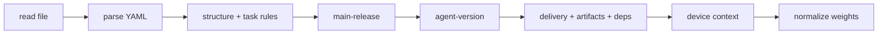

# Tasks

The [manifest](./deploy-v2-overview) YAML reference — every field, how it's validated, and how
placeholders and progress work.

An `install.yaml` has two levels: the **manifest** (top-level) and its **tasks**, grouped into named
[lifecycle actions](./deploy-v2-lifecycle-actions).

## Minimal example

The smallest valid manifest installs a single MSI:

```yaml
ReleaseId: ID.MyApp@1.4.0
Type: Deploy/V2
Actions:
  install:
    Tasks:
      - Type: Execute/v2
        DeployType: MSI
        ExeFile: my-app.msi
```

A legacy manifest with a top-level `Tasks:` list (no `Actions:`) is still accepted — its tasks
become the `install` action.

## Manifest-level fields

```yaml
ReleaseId: ID.MyApp@1.4.0     # required — must match the release being deployed
Type: Deploy/V2               # required — always exactly "Deploy/V2"
MinAgentVersion: 2.0.0        # optional — minimum agent semver required to run this manifest
Actions:                      # required — named actions, each with its own task tree
  install:
    Tasks:
      - ...
```

| Field | Required | Description |
|---|---|---|
| `ReleaseId` | ✅ | The release this manifest installs. **Must equal** the catalog id of the release being deployed (guards against a stale/mismatched `install.yaml`). The all-caps `ReleaseID` spelling is also accepted. |
| `Type` | ✅ | The manifest kind. Must be the literal `Deploy/V2`. |
| `MinAgentVersion` | ❌ | A semver string. If the running agent is older, the deploy fails before any task runs. Omit to skip. |
| `Actions` | ✅ | A map of action name → `{ Tasks, Repeatable?, Description? }`. Must contain at least one action. See [Lifecycle Actions](./deploy-v2-lifecycle-actions). |
| `Tasks` | — | **Deprecated** legacy form: a top-level task list, used as the `install` action. Not allowed together with `Actions`. |

:::note Field-name casing
Manifest keys are **PascalCase** (`ReleaseId`, `Type`, `Actions`, `Tasks`). The release identifier also
accepts the all-caps `ReleaseID` spelling — both `ReleaseId` and `ReleaseID` are valid, at the
manifest level and on a `Deploy/v2` / `FleetDeploy/v2` task. Action names and placeholder
**sources** (`Device`, `Env`, `Config`, `ConfigJson`, `ConfigPath`, `DeviceConfig`, `Release`) are
matched case-insensitively, but write manifest keys as shown.
:::

## Task-level fields

```yaml
Tasks:
  - Type: Execute/v2           # required — the kind of task
    Name: install-app          # optional — label used in the log and status lines
    DeployType: MSI            # required — the method used to run it
    ExeFile: my-app.msi        # the delivered artifact to run
    Rule: { ... }              # optional — device must satisfy this or the deploy fails
    Arguments: "/qn PORT=8080" # optional — CLI arguments, may contain {placeholders}
    Weight: 60                 # optional — relative share of the progress bar
    LaunchTimeoutSec: 60       # optional — seconds allowed to start the process
    ExecutionTimeoutMin: 15    # optional — minutes allowed to finish
```

Task types and what they do live on [Action](./deploy-v2-action). Deploy methods:

| Group | Values | Used by |
|---|---|---|
| **Install** | `MSI`, `RPM`, `DEB`, `Script`, `API` | `Execute` |
| **Uninstall / removal** | `MSI_Uninstall`, `RPM_Uninstall`, `DEB_Uninstall`, `Script`, `API` | `Execute`, `Revert` |
| **Verify** | `API` (2xx = pass), `Script` (exit 0 = pass), `SSE` (wait for a matching frame) | `Verification` |
| **Reserved** | `DockerCompose`, `Helm`, `Command` | — |

A **dependency** task looks different — it has `Type: Deploy/v2`, an `Action` to run, and an
optional `ReleaseId` (omitted = this release), carrying no `ExeFile`/`DeployType` (see
[Orchestrator](./deploy-v2-orchestrator) and [Lifecycle Actions](./deploy-v2-lifecycle-actions#from-another-task)).
A **group** task has `Type: Group/v2` and a `Tasks` list, carrying no `DeployType`/`ExeFile` of its
own. A **fleet rollout** task has `Type: FleetDeploy/v2`, an `Action`, an optional `ReleaseId`, and
a required `Rule` (plus optional `Scope` and `CompletionPolicy`) — it runs that action across the
managed fleet, carrying no `ExeFile`/`DeployType` (see
[Fleet deploy](./deploy-v2-orchestrator#fleet-deploy-across-managed-devices)).

:::note "Command" is reserved, not runnable today
`Command` is a planned deploy method — a raw command line, alongside `API`, without a
delivered script file. It isn't runnable yet: a raw command line today is what `Script`
already covers. On the dashboard's release-authoring side there's also a *separate*,
not-yet-live concept with the same name (`command`, alongside `import`/`api`) reserved as a
future way to source a component beyond uploading a file — see
[Attach an Artifact](../../release/attach-artifact). The two aren't wired together yet.
:::

### What to enter, per method

| `DeployType` | What you must supply | Optional |
|---|---|---|
| `MSI` / `RPM` / `DEB` | `ExeFile` — the delivered installer package | `Arguments` |
| `Script` (install) | `ExeFile` — the delivered script | `Arguments` |
| `API` (install/verify) | `Target` — the endpoint URL | `Method`, `Header`, `Body`, `Params` |
| `SSE` (verify) | `Target` — the event-stream endpoint, `Message` — the frame to match | `GraceTimeSec` |
| `*_Uninstall` | `ExeFile` **or** `Target` — the package/product-code handle | `Force`, `Arguments` |
| `Script` (revert) | `ExeFile` — the cleanup script | `Arguments`, `Force` |
| `API` (revert) | `Target` — the removal endpoint | `Method`, `Header`, `Body`, `Params`, `Force` |

### Full field reference

| Field | Applies to | Description |
|---|---|---|
| `Type` | all | The task kind — see [Action](./deploy-v2-action). |
| `Name` | all | An optional label for the task, shown in the deploy log and status lines instead of its file/target. |
| `DeployType` | Execute, Verification, Revert | The method that runs the task (table above). Must be compatible with `Type`. |
| `ExeFile` | Execute, Revert (file/uninstall methods) | The delivered artifact to run — an installer, a script, or an uninstaller/package. |
| `Target` | Execute/Verification/Revert (API/SSE/uninstall) | A non-file handle: an endpoint URL (API/SSE) or a removal handle — product code / package name (uninstall). May contain `{placeholders}`. |
| `ReleaseId` | Deploy, FleetDeploy | The release whose action a `Deploy/v2` runs on this device or a `FleetDeploy/v2` runs across the fleet. Optional — omitted (or equal to the manifest's own) means **this release**. The all-caps `ReleaseID` spelling is also accepted. |
| `Action` | Deploy, FleetDeploy | The [lifecycle action](./deploy-v2-lifecycle-actions) of the target release to run (e.g. `install`, `restart`, `uninstall`). Omitted means `install` — deprecated, always set it. |
| `Tasks` | all | A nested list of child tasks this task binds and awaits (see [Orchestrator](./deploy-v2-orchestrator)). |
| `Rule` | all | A rule-engine condition evaluated on the device right before the task runs. YAML object or inline JSON string. |
| `Arguments` | Execute, Revert | A single CLI argument string for the process. May contain `{placeholders}`. |
| `Message` | Verification (SSE) | The expected object a stream frame must match to pass; string values may be `{placeholders}`. |
| `Method` | Execute/Verification (API) | HTTP method for an API call (default `GET`). |
| `Header` | API / SSE | Request headers map. |
| `Body` | API / SSE | Request body. |
| `Params` | API / SSE | URL query parameters, percent-encoded; may contain `{placeholders}`. |
| `Weight` | all | The task's share of the progress bar **within its sibling list** (see [Progress & weights](#weights--progress)). |
| `CausesReboot` | Execute | Declares the task reboots the device. Requires a nested `Verification` child — see [Action](./deploy-v2-action#reboot-tasks). |
| `Force` | Execute/Revert (uninstall methods) | Forces the removal — e.g. treat "not installed" as success, ignore dependencies. |
| `GraceTimeSec` | Verification (and any retryable task) | Grace window within which a failed run is retried before the task fails. |
| `RetryCount` | retryable tasks | Maximum attempts before failing. |
| `RetryBackoffSec` | retryable tasks | Delay between retries. |
| `LaunchTimeoutSec` | Execute | Time to *launch* before failing. Literal or `{placeholder}`. Default `60`; falls back to `Release.metadata.timeoutLaunch`. |
| `ExecutionTimeoutMin` | Execute + any parent/group | Time to *complete* before it's killed. Literal or `{placeholder}`. Default `15`; falls back to `Release.metadata.timeoutInstallation`. On a parent it bounds the **whole subtree**. |
| `Scope` | FleetDeploy | Which slice of the managed fleet to target — `Platform` (default), `Reactive`, or `All`. |
| `CompletionPolicy` | FleetDeploy | How success/failure propagates across matched devices — `AllConnected` (default), `Partial`, or `AllReachable`. |

**Reserved fields** (parsed but ignored today):

| Field | Future task type | Purpose |
|---|---|---|
| `ConfigGroup` | Config | The config group name to apply. |
| `TryRollbackToPrevious` | Revert | Reinstall the previous version before uninstalling. |

## Validation & requirements

Before **any** task runs, the manifest is validated for the action being run. A failure at any
stage marks that action `Error` and writes the reason to the deploy log — an action either runs
cleanly or is rejected up front; it never half-applies. Only the **invoked action** (and every action
it runs through `Deploy/v2`) is checked, so a flaw in an unrelated action never blocks this one.



| Stage | What it checks |
|---|---|
| **read** | `install.yaml` can be read from disk. |
| **parse** | Valid YAML that deserializes into a manifest. |
| **structure + task rules** | `ReleaseId` not empty, `Type` is `Deploy/V2`, at least one action. For the invoked action: every task individually valid, task ordering valid (each `Verification`/`Revert` has a target), every `Group` non-empty, and every rebooting task has a nested `Verification`. |
| **main-release** | The manifest's `ReleaseId` equals the release being deployed. |
| **agent-version** | Running agent semver ≥ `MinAgentVersion` (skipped if absent/unparsable). |
| **artifacts** | Across the whole tree the action runs: every release's delivery is `Done` (download status and lifecycle state) with all its artifacts present on the agent's disk; every task's `ExeFile` exists; every `Deploy/v2` target action exists and is itself validated — another release must be a registered dependency of its parent, delivered and ready, and itself a V2 component. A `FleetDeploy/v2` target is checked for existence only (each remote device validates its own tree). |
| **device context** | Device metadata gathered for rule evaluation and placeholder resolution. |
| **normalize weights** | Weights of the invoked action scaled so each sibling list sums to 100. |

### Per-task input rules

- **`Execute`** — needs the input for its `DeployType`: a delivered `ExeFile` for
  `MSI`/`RPM`/`DEB`/`Script`; a `Target` (endpoint URL) for `API`; a removal handle —
  `ExeFile` or `Target` — for `*_Uninstall`
- **`Verification`** — needs a verify `DeployType` (`API`/`Script`/`SSE`); an `SSE`
  verification additionally requires a `Message` object; an `API` call's `Method`, if given,
  must be a valid HTTP verb
- **`Revert`** — needs a removal `DeployType` (`*_Uninstall`/`Script`/`API`) and its handle
- **`Deploy`** — a self-targeted `Action` (no `ReleaseId`, or the manifest's own) must exist in
  this manifest; another release's action is checked when the tree is walked
- **`FleetDeploy`** — needs a `Rule` that selects the target fleet; a self-targeted `Action` must
  exist in this manifest; `Scope` and `CompletionPolicy` are optional
- **`Group`** — must bind a non-empty `Tasks` list
- `DeployType` must be compatible with `Type` (table above)
- A `Rule`, if present, must contain at least one condition (`and`/`or`/`none`)

### Task-ordering rules

A `Verification` or `Revert` only makes sense when it has something to act on — see
[Action](./deploy-v2-action) for what triggers each and how nesting works. Validation checks this within
each `Tasks` list and reports the offending **chain path** (e.g. `Task[1.0.2]`).

### Requirements checklist

For a manifest to deploy successfully on a device:

- [ ] `ReleaseId` matches the deployed release exactly, and `Type` is `Deploy/V2`
- [ ] Agent version ≥ `MinAgentVersion` (if set)
- [ ] Every release in the tree has a `Done` delivery (status **and** state) with all its
      artifacts present on disk
- [ ] Every task supplies its method's input (`ExeFile` / `Target` / `Action` / non-empty
      `Tasks`)
- [ ] Every `Verification`/`Revert` has a target; every `Group` is non-empty; every rebooting
      task has a nested `Verification`
- [ ] Every `Deploy/v2` target action exists; another release is a registered dependency of its
      parent, ready, and ships its own `install.yaml`
- [ ] Every task's `Rule` passes on the target device, and every `{placeholder}` resolves to a
      value that fits its slot

## Placeholders — dynamic values at runtime

Placeholders of the form `{Source.Path}` are resolved on the device, just before the task runs, in
`Arguments`, `Target`, `Header` and `Params` values, the `Body`, a verification `Message`, and both
timeout fields.

**Syntax:** `{Source.Path}` — `Source` is one of the sources below (case-insensitive); `Path` is a
dotted path into that source (letters, digits, `_` and `.`).

| Source | Resolves from | Example | Resolves to |
|---|---|---|---|
| `Device` | The device metadata/context tree — see [Context](./deploy-v2-context) | `{Device.type}`, `{Device.os.name}` | `Namer`, `windows` |
| `Release` | The release record; metadata under `Release.metadata.*` | `{Release.version}`, `{Release.metadata.timeoutInstallation}` | `1.4.0`, `20` |
| `Config` | The device's synced **config groups** ([GetConfig](../../../../technician/agent/configurations/getconfig)) — a group, or a value inside it | `{Config.network.proxy.host}` | `10.0.0.5` |
| `ConfigJson` | The same node as `Config`, always as compact JSON text | `{ConfigJson.network}` | `{"proxy":{"host":"10.0.0.5"}}` |
| `ConfigPath` | The absolute path of a config group's YAML file on the device | `{ConfigPath.network}` | `C:\…\network.yaml` |
| `DeviceConfig` | The agent's own runtime settings (`config.yaml`), dotted by zone | `{DeviceConfig.device.meta_data.name}` | the configured value |
| `Env` | An OS environment variable | `{Env.COMPUTERNAME}` | the env value |

```yaml
Tasks:
  - Type: Execute/v2
    DeployType: MSI
    ExeFile: my-app.msi
    Arguments: "/qn PORT={Config.app.port} DEVICE={Device.id} SITE={DeviceConfig.device.meta_data.name}"
```

On a device with id `dev-42`, an `app` config group whose `port` is `8080`, and device name `north`,
the resolved command line becomes `/qn PORT=8080 DEVICE=dev-42 SITE=north`.

:::caution `Config` changed meaning
`{Config.*}` reads the device's **synced config groups**. Manifests that used `{Config.*}` for the
agent's runtime `config.yaml` settings must switch to `{DeviceConfig.*}`.
:::

### Config groups in depth

- **Group vs. value** — `{Config.<group>}` is the whole group; `{Config.<group>.<key.path>}` is the
  value at that path (scalar, object or array).
- **Dotted group names** — a path resolves by the *shortest* prefix that names a group:
  `{Config.getmap.delivery}` is the `delivery` key of the `getmap` group when that group exists, and
  falls back to a group named `getmap.delivery` when it doesn't.
- **Nested placeholders** — a `{…}` placeholder stored inside a config value is resolved too.
- **Fit to the slot** — a text slot (`Arguments`, `Target`, a header or query-param value, or a
  placeholder inside longer text) needs a **scalar**; a group or object there is an error. To embed a
  whole group or object, make it the **only** content of a `Body` (or `Message`) value —
  `config: "{Config.network}"` — and it is inserted as real JSON. To pass it as text on purpose, use
  `{ConfigJson.*}`.
- **Hand a tool the file** — `{ConfigPath.<group>}` gives the group's file path, so a script or
  service can read the whole group itself.

```yaml
- Type: Execute/v2
  DeployType: API
  Method: POST
  Target: "http://localhost:9000/config/import"
  Params:
    cfg: "{ConfigJson.network}"        # text slot → the group as JSON text
  Body:
    site: "{Config.network.site}"      # a scalar value
    config: "{Config.network}"         # the whole group, embedded as an object
```

**Rules & gotchas**

- Outside `Config` / `ConfigJson` in a `Body` or `Message`, a placeholder must resolve to a
  **scalar** (string, number, bool) — an object/array is an error
- An unresolvable placeholder (missing key, unknown source, missing config group) fails the task —
  it's never left unresolved in the string
- Timeout fields accept a literal or a placeholder: `ExecutionTimeoutMin:
  "{Release.metadata.timeoutInstallation}"`; if it doesn't resolve to a number, the default is used
- When a timeout field is omitted, the engine uses, in order: the release-metadata default,
  then the built-in default (`60` s to launch, `15` min to complete)

## Weights & progress

Each task can carry a `Weight` — its share of the progress bar. Weights are **normalized per
sibling list**, so each `Tasks` list sums to 100:

- If no task in a list sets a weight, that list's progress is distributed evenly
- If weights are set but don't sum to 100, they're scaled proportionally (the last task
  absorbs rounding)

A leaf's real share of the whole bar is its weight × the weight of each ancestor on the way up.

### How a parent splits its share

How a parent divides its share between **its own step** and its children depends on the parent's
type:

- A **`Group/v2`** runs no step of its own — it is a pure container, so its children take its
  **entire** share.
- An **actionable parent** (an `Execute` that also binds children) runs its own install *and*
  its children, so it reserves **one slot for itself**: with `N` children the parent's own step
  takes `1/(N+1)` of the node's share and the children split the remaining `N/(N+1)`.

So an `Execute` with one nested `Verification` splits that node 50/50 — the install is half,
the check is half.

### What counts as progress

Progress is the sum, across the tree, of each leaf's share × how far that leaf has got:

- A leaf that reached a **terminal-complete** state (`Done` or `Skipped`) counts in full.
- A leaf still **running a sub-deploy** — a `Deploy/v2` dependency or a `FleetDeploy/v2` rollout
  — counts **partially**, folding in its children's live progress rather than jumping from 0 to
  100. For a fleet, each target device contributes an even split of its delivery and deploy
  phases, and the task's progress is the mean across the devices it is acting on.
- Any other leaf counts as 0 until it completes.

```yaml
Tasks:
  - Type: Execute/v2
    DeployType: MSI
    ExeFile: big-package.msi
    Weight: 80                 # 80% of this list
  - Type: Execute/v2
    DeployType: Script
    ExeFile: quick-config.ps1
    Weight: 20                 # 20%
```

Weights are cosmetic (progress reporting only) — they don't affect ordering or
success.

## See also

- [Overview](./deploy-v2-overview)
- [Action](./deploy-v2-action)
- [Orchestrator](./deploy-v2-orchestrator)
- [Example](./deploy-v2-example)
